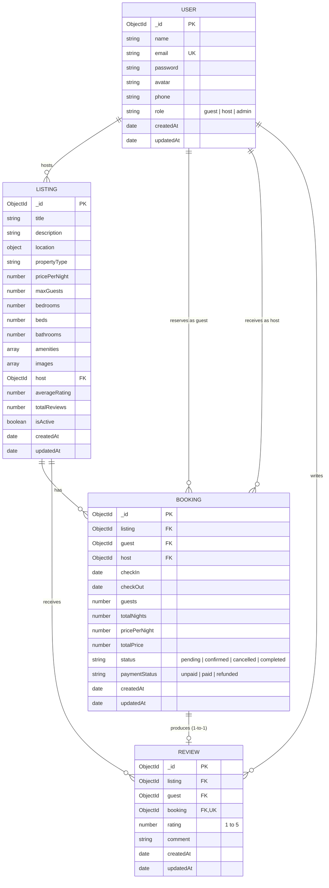

# StayScape — Database Schema Documentation

StayScape uses MongoDB with Mongoose ODM. This document outlines the schema design, field constraints, relationships, and indexing strategies.

---

## 1. Entity-Relationship Diagram (ERD)



---

## 2. Collection Schemas

### 2.1 Users Collection (`User.js`)
Stores authenticated user records for guests, hosts, and platform administrators.

| Field | Type | Required | Default | Description / Constraints |
| :--- | :--- | :--- | :--- | :--- |
| `_id` | `ObjectId` | Yes | Auto | Unique MongoDB Identifier |
| `name` | `String` | Yes | — | User's full name, max 50 chars, trimmed |
| `email` | `String` | Yes | — | Unique, lowercase, validated by regex |
| `password`| `String` | Yes | — | BCRYPT hashed, `select: false` (never returned in queries) |
| `avatar` | `String` | No | `""` | URL to user's profile photograph |
| `phone` | `String` | No | `""` | Optional contact telephone number |
| `role` | `String` | Yes | `'guest'` | Enum: `['guest', 'host', 'admin']` |
| `createdAt`| `Date` | Auto | Now | Timestamp of registration |
| `updatedAt`| `Date` | Auto | Now | Timestamp of last modification |

**Schema Hooks & Methods:**
- `pre('save')`: Hashes `password` using `bcrypt.genSalt(10)` if modified.
- `methods.matchPassword(entered)`: Compares candidate password against bcrypt hash.
- `methods.toJSON()`: Automatically strips the `password` field when document is serialized to JSON.

---

### 2.2 Listings Collection (`Listing.js`)
Stores property listings created by hosts.

| Field | Type | Required | Description / Constraints |
| :--- | :--- | :--- | :--- |
| `_id` | `ObjectId` | Yes | Unique Identifier |
| `title` | `String` | Yes | Title, max 100 characters |
| `description` | `String` | Yes | Description, max 2000 characters |
| `location.address` | `String` | Yes | Street address |
| `location.city` | `String` | Yes | City name, indexed |
| `location.state` | `String` | Yes | State / province |
| `location.country` | `String` | Yes | Country name |
| `location.latitude` | `Number` | No | Coordinate for map positioning |
| `location.longitude` | `Number`| No | Coordinate for map positioning |
| `propertyType` | `String` | Yes | Enum: `['apartment', 'house', 'villa', 'condo', 'cabin', 'cottage', 'studio', 'loft', 'chalet', 'other']` |
| `pricePerNight`| `Number` | Yes | Price per night (min: 0), indexed |
| `maxGuests` | `Number` | Yes | Maximum guest capacity (min: 1) |
| `bedrooms` | `Number` | Yes | Number of bedrooms (default: 1) |
| `beds` | `Number` | Yes | Number of beds (default: 1) |
| `bathrooms` | `Number` | Yes | Number of bathrooms (default: 1) |
| `amenities` | `[String]` | No | Array of strings (e.g. Wifi, Kitchen, Pool) |
| `images` | `[String]` | Yes | Array of image URLs (min 1 required) |
| `host` | `ObjectId` | Yes | Reference to `User` model, indexed |
| `averageRating`| `Number` | No | Default: 0, bounded 0-5, rounded to 1 decimal |
| `totalReviews` | `Number` | No | Default: 0 |
| `isActive` | `Boolean` | No | Default: true, indexed |

**Indexes:**
- Text Search: `{ title: 'text', description: 'text', 'location.city': 'text', 'location.country': 'text' }`
- Compound Filter: `{ 'location.city': 1, pricePerNight: 1, maxGuests: 1 }`

---

### 2.3 Bookings Collection (`Booking.js`)
Stores property reservations placed by guests.

| Field | Type | Required | Default | Description / Constraints |
| :--- | :--- | :--- | :--- | :--- |
| `_id` | `ObjectId` | Yes | Auto | Unique Identifier |
| `listing` | `ObjectId` | Yes | — | Ref `Listing`, indexed |
| `guest` | `ObjectId` | Yes | — | Ref `User` (the traveler), indexed |
| `host` | `ObjectId` | Yes | — | Ref `User` (the listing owner), indexed |
| `checkIn` | `Date` | Yes | — | Check-in date |
| `checkOut` | `Date` | Yes | — | Check-out date (validated to be after `checkIn`) |
| `guests` | `Number` | Yes | 1 | Number of guests (min: 1) |
| `totalNights` | `Number` | Yes | — | Calculated nights count (min: 1) |
| `pricePerNight`| `Number` | Yes | — | Server-captured price per night |
| `totalPrice` | `Number` | Yes | — | Computed server-side: $totalNights \times pricePerNight$ |
| `status` | `String` | Yes | `'confirmed'` | Enum: `['pending', 'confirmed', 'cancelled', 'completed']` |
| `paymentStatus`| `String` | Yes | `'unpaid'` | Enum: `['unpaid', 'paid', 'refunded']` |

**Indexes:**
- Double-Booking Conflict Index: `{ listing: 1, status: 1, checkIn: 1, checkOut: 1 }`
- History Indexes: `{ guest: 1, createdAt: -1 }`, `{ host: 1, createdAt: -1 }`

---

### 2.4 Reviews Collection (`Review.js`)
Stores reviews and ratings submitted by guests after completed stays.

| Field | Type | Required | Description / Constraints |
| :--- | :--- | :--- | :--- |
| `_id` | `ObjectId` | Yes | Unique Identifier |
| `listing` | `ObjectId` | Yes | Reference to `Listing`, indexed |
| `guest` | `ObjectId` | Yes | Reference to `User` who stayed |
| `booking` | `ObjectId` | Yes | Reference to `Booking`, **Unique Index** (1 review per booking) |
| `rating` | `Number` | Yes | Integer or decimal rating (min: 1, max: 5) |
| `comment` | `String` | Yes | Review text, max 1000 characters |

**Automatic Rating Aggregation Pipeline:**
```javascript
reviewSchema.statics.calculateAverageRating = async function (listingId) {
  const stats = await this.aggregate([
    { $match: { listing: new mongoose.Types.ObjectId(listingId) } },
    {
      $group: {
        _id: '$listing',
        averageRating: { $avg: '$rating' },
        totalReviews: { $sum: 1 }
      }
    }
  ]);

  if (stats.length > 0) {
    await mongoose.model('Listing').findByIdAndUpdate(listingId, {
      averageRating: Math.round(stats[0].averageRating * 10) / 10,
      totalReviews: stats[0].totalReviews
    });
  } else {
    await mongoose.model('Listing').findByIdAndUpdate(listingId, {
      averageRating: 0,
      totalReviews: 0
    });
  }
};
```
Hooks `post('save')` and `post('findOneAndDelete')` call this method to guarantee data synchronization between `Review` and `Listing` collections.
