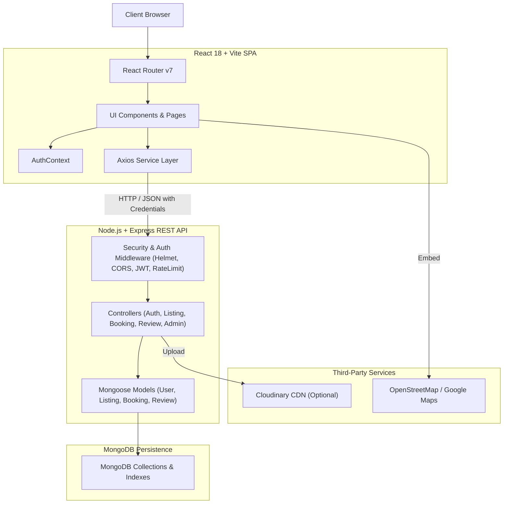
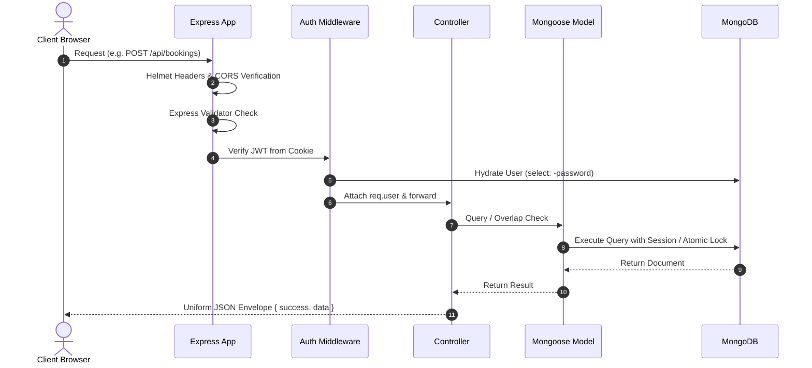

# StayScape — System Architecture & Design

This document details the architectural design, patterns, and component hierarchy of the **StayScape** Full Stack Airbnb Clone platform.

---

## 1. High-Level Architecture

StayScape follows a decoupled, client-server Model-View-Controller (MVC) architecture with a modern Single Page Application (SPA) frontend and a RESTful API backend:



---

## 2. Frontend Architecture

### 2.1 Component Structure
The frontend is structured into modular layers:
- **`components/layout/`**: `Navbar`, `Footer`, and adaptive navigation menus.
- **`components/listings/`**: `ListingCard`, `CategoryFilter`, `SearchBar`, and `ReviewsSection`.
- **`components/booking/`**: `BookingCard` featuring interactive check-in/check-out date pickers with active booking exclusion and payment simulation.
- **`components/common/`**: Reusable design primitives (`MapComponent`, `ProtectedRoute`, `SkeletonCard`, `EmptyState`, `ErrorState`, `LoadingSpinner`).
- **`pages/`**: View controllers corresponding to top-level routes (`HomePage`, `ListingsPage`, `ListingDetailsPage`, `LoginPage`, `RegisterPage`, `ProfilePage`, `MyBookingsPage`, `HostDashboardPage`, `HostListingsPage`, `AdminDashboardPage`, `NotFoundPage`).

### 2.2 State Management
- **Authentication State**: Managed via `AuthContext.jsx`. The application verifies session identity on startup via `GET /api/auth/me`. The JWT token is securely stored in an HTTP-only cookie, avoiding any local storage vulnerabilities.
- **URL-Driven Filter State**: In `ListingsPage.jsx`, search criteria (`keyword`, `city`, `propertyType`, `minPrice`, `maxPrice`, `guests`, `sort`, `page`) are synced with URL search parameters. This enables shareable URLs and seamless browser history navigation without unexpected full-page refreshes.
- **Calendar Availability State**: In `BookingCard.jsx`, the component communicates with `GET /api/bookings/availability/:listingId` to disable already-booked date intervals in real-time.

---

## 3. Backend Architecture

### 3.1 Modular MVC Organization
```
backend/src/
├── config/             # DB & Cloudinary configurations
├── controllers/        # Business logic & request processing
├── middleware/         # Security, auth, error handling & upload
├── models/             # Mongoose schemas, hooks & static methods
├── routes/             # REST endpoint route mappings
├── utils/              # Token generation & API query features
├── app.js              # Express app definition & global middlewares
└── server.js           # Server bootstrap & process lifecycle
```

### 3.2 Request Lifecycle


---

## 4. Security Architecture

1. **HTTP-Only Cookie Authentication**:
   - JWT tokens are issued with `httpOnly: true`, preventing JavaScript theft via Cross-Site Scripting (XSS).
   - `sameSite: 'lax'` in development, `'none'` in production with `secure: true`.
2. **Password Hardening**:
   - `bcryptjs` salt rounds set to 10.
   - Pre-save hook automatically hashes passwords only when modified.
   - Passwords explicitly excluded in queries via `select: false` on the User schema and omitted from `toJSON()` serialization.
3. **Role-Based Access Control (RBAC)**:
   - Three discrete roles: `guest`, `host`, `admin`.
   - Middleware `protect` authenticates the token; `authorize('host', 'admin')` restricts management actions.
   - Hosts can only modify or delete listings they own (`listing.host === req.user._id`).
4. **Brute-Force & Denial-of-Service Defense**:
   - `express-rate-limit` throttles auth endpoints to 30 requests per 15-minute window per IP.
   - `express.json({ limit: '10mb' })` guards against payload exhaustion attacks.
   - `helmet` sets standardized security response headers.
